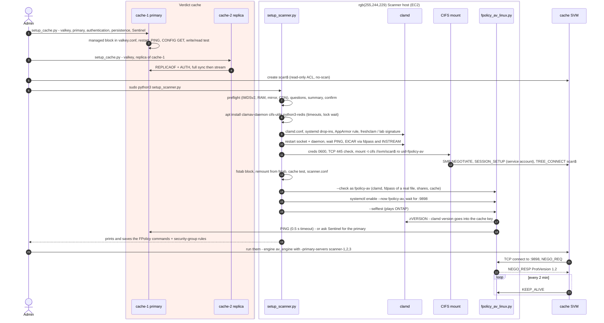
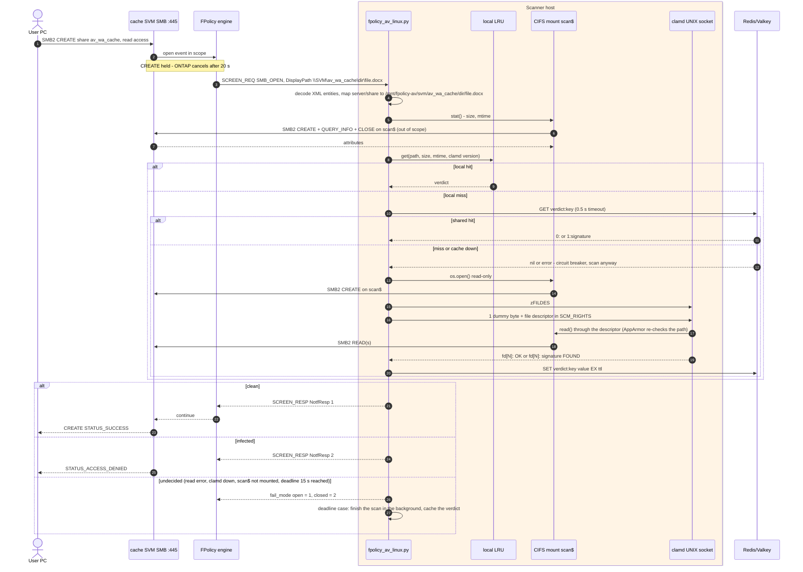
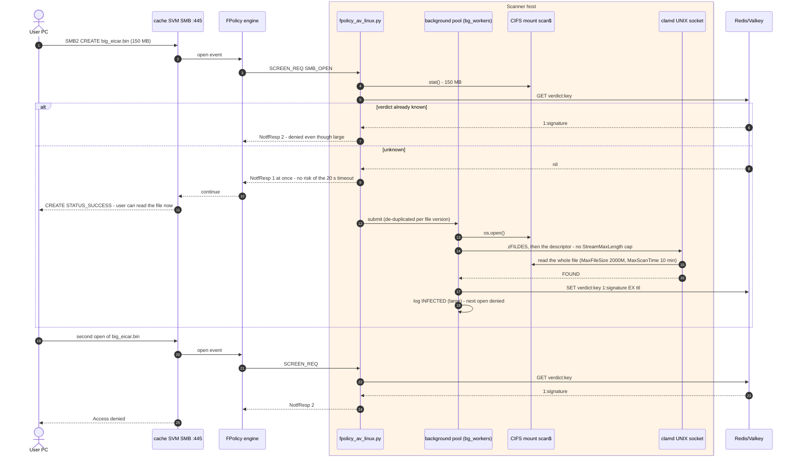
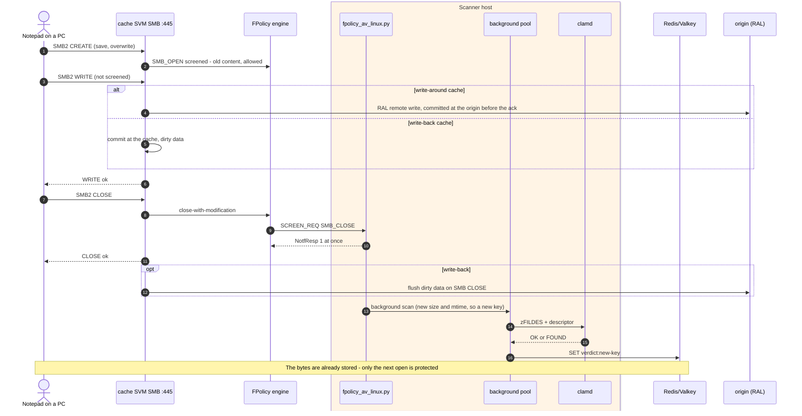
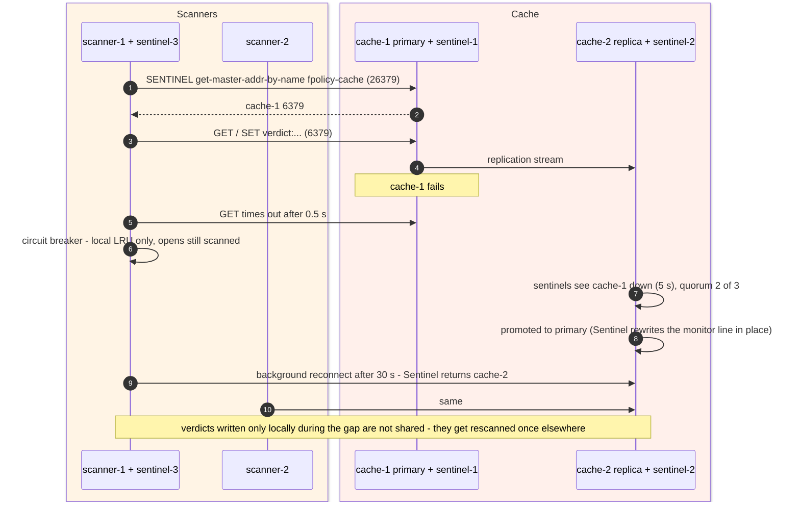

# FlexCache Antivirus Scanning with ONTAP FPolicy and ClamAV - Pilot Runbook

**What this document is.** A pilot design, with installation, operating and test procedures, for scanning
files for malware when SMB clients access data through ONTAP FlexCache volumes. Linux scanner hosts receive
ONTAP FPolicy notifications, scan files with the open-source ClamAV engine, and tell ONTAP to allow or deny
each open. A typical pilot uses Ubuntu instances on Amazon EC2 next to an FSx for NetApp ONTAP cache SVM.

**Status: a prototype, ready for a pilot.** Two install wizards (`setup_scanner.py`, `setup_cache.py`)
build everything and print each step as they go. The scanner and the configurations the wizards generate
were tested in a lab against the Ubuntu 22.04 and 24.04 packages:

- ClamAV 1.5.4;
- Redis 6.0.16, including a Sentinel failover;
- the clamd AppArmor profile.

The first pilot step is an end-to-end run against your SVM.

**Not a NetApp-supported antivirus integration.** NetApp's supported antivirus design for FlexCache is:

- on-access Vscan with a partner antivirus engine, for clients connected to the origin;
- scheduled on-demand scans at the origin (TR-4743).

This pilot adds screening at the cache on top of that design; it doesn't replace it.

---

## 1. Why scan at the cache

ONTAP on-access antivirus scanning (Vscan) runs in the SMB layer of the SVM a client is connected to.
Traffic between a FlexCache volume and its origin is not SMB, so:

- a file read through a cache is served without an on-access scan, even when the origin has Vscan with
  mandatory scanning turned on;
- a file written through a cache reaches the origin without an on-access scan;
- turning on Vscan on the cache SVM has no effect on FlexCache volumes.

NetApp documents this in TR-4743 ("FlexCache operations are not SMB operations, and therefore you must use
the on-demand scanning schedule") and in the KB *On-access scan does not occur when accessing FlexCache
volume*. Lab tests on ONTAP 9.19.1 confirmed it for both write-around and write-back caches.

ONTAP FPolicy, by contrast, is supported on FlexCache volumes over SMB from ONTAP 9.14.1. With a
**synchronous** external engine, ONTAP holds each monitored SMB operation until an external server answers
allow or deny. This design uses that hook to scan files at the cache.

---

## 2. How it works

1. A user opens a file on a watched share of the cache SVM. ONTAP holds the open and sends a screen
   request to one of the scanner hosts (TCP 9898, round robin across all scanners).
2. The scanner looks the file up in its verdict cache (path, size, modification time and signature
   version). A known verdict is answered at once.
3. Otherwise the scanner opens the file through a read-only CIFS mount of a hidden `scan$` share, which is
   outside the FPolicy scope. It hands the open file to ClamAV over a local socket.
4. It answers allow or deny. A denied user sees "Access denied".
5. When a modified file is closed, the scanner allows the close at once and rescans the file in the
   background, so the next open of an infected file is denied.

| Topic | Behaviour |
|-------|-----------|
| Placement | Scanner hosts on the cache's LAN or VPC, so screening never crosses the WAN |
| Scale and availability | Several scanners listed in `-primary-servers`; ONTAP spreads the requests across them |
| File access | Read-only `scan$` share, dedicated domain service account, mounts readable only by the service user |
| Scanning | ClamAV `clamd` on each scanner, given an open file descriptor (fdpass): no file copies, no streaming size cap |
| Response time | Files up to 100 MB (configurable) are scanned while the open waits. The scanner always answers within a deadline (default 15 s; ONTAP cancels at 20 s) |
| Large files | Allowed at once and scanned in the background; the next open is denied if the file is infected |
| Verdict cache | A local cache plus an optional shared Redis or Valkey cache with automatic failover (Sentinel): one scan serves every scanner and survives restarts |
| Failure handling | Fail-open or fail-closed, matching ONTAP's `-is-mandatory` setting |
| Operations | systemd service, log rotation, health check (`--check`), FPolicy self-test (`--selftest`), statistics every 5 minutes |

---

## 3. Prerequisites

- **ONTAP:** 9.14.1 or later on the cluster that hosts the FlexCache volumes (FPolicy on FlexCache over
  SMB). FSx for NetApp ONTAP is supported.
- **SVM:** a CIFS server on the cache SVM, joined to Active Directory.
- **Service account:** a domain account for the scanners, with read access to the files in the watched
  shares.
- **Scanner and cache hosts:**
  - Ubuntu 22.04 or 24.04 with systemd, and root access.
  - 4 GB of RAM or more on scanners: the full ClamAV database needs about 1.5 GB.
- **Network:**
  - TCP 9898 from the SVM data LIFs to the scanners;
  - TCP 445 from the scanners to the SVM;
  - HTTPS to the ClamAV signature CDN, and HTTP/HTTPS to an Ubuntu mirror (direct, through NAT or
    through a proxy);
  - TCP 6379 and 26379 between the scanners and the cache nodes, when a shared cache is used.

---

## 4. Topology

```
            SITE A / VPC A (origin)                                SITE B / VPC B (cache, e.g. FSx for ONTAP)
  +-------------------------------+                    +---------------------------------------------------------+
  | origin cluster  (RAL monitor) | <== RAL 11104/5 ==> | cache SVM :445 + FPolicy engine av_pol                  |
  | AD / DNS                      |                    |     |  ^ 9898 (ONTAP -> scanners, round robin)            |
  +-------------------------------+                    |     v  |                                                 |
                                                        |  scanner-1..3 (EC2, Ubuntu): fpolicy-av + clamd         |
          user PCs (any site) ---- SMB 445 -----------> |      mount //svm/scan$ (ro)  <---- 445 ----             |
                                                        |      verdicts ----> cache-1 PRIMARY :6379 <- cache-2    |
                                                        |                    Sentinel :26379 x3 (optional)        |
                                                        +---------------------------------------------------------+
```

Suggested starting layout (to be validated with measured open rates during the pilot):

| Role | Count | Per host (EC2 example) |
|------|-------|----------|
| Scanner (`fpolicy_av_linux.py` + `clamd`) | 3, all listed in `-primary-servers` | 8 vCPU, 16 GB RAM (e.g. m6i.2xlarge); 4 GB is the minimum for small tests |
| Verdict cache | 1 primary + 1 replica | 2 vCPU, 4-8 GB RAM (e.g. r6i.large or t3.large) |
| Sentinel (optional) | 3: both cache nodes + one scanner (`setup_cache.py` role `sentinel`) | Negligible |

**AWS security groups**

| Group | Inbound rule | Why |
|-------|--------------|-----|
| scanner SG | TCP 9898 from the SVM's data LIF IPs (FSx console, Endpoints tab), or from the FSx file system's SG | ONTAP opens the FPolicy connection to the scanner |
| FSx / SVM SG | TCP 445 from the scanner SG | `scan$` mount |
| cache SG | TCP 6379 and 26379 from the scanner SG and from the cache SG itself | Verdicts, replication, Sentinel |
| scanner SG outbound | 445 to the SVM, 443 to `database.clamav.net`, 80/443 to the Ubuntu mirror, 6379/26379 to the cache | Default "all outbound" covers it |

---

## 5. Glossary

| Entity | What it is |
|--------|-----------|
| **`scan$` share** | A hidden SMB share on each SVM, pointing at `/` (the SVM namespace root). It has Vscan profile `no-scan`, is **not** in the FPolicy scope, and its ACL is read-only for the scanner account. It's the scanner's back door to read the bytes it screens without triggering itself. No administrator rights are needed. |
| **Kernel CIFS client** | Linux's SMB client (`cifs.ko`, mounted with `mount.cifs` from `cifs-utils`). Mounted with `cache=none,actimeo=0` so `stat()` always returns the current size and mtime; without that, stale verdicts would be reused. |
| **Credentials file** | `/etc/fpolicy-av/creds/<svm>.cred`, mode 0600 root: the service account's logon details for `mount.cifs`. The mount and `/etc/fstab` reference it, so the host can remount unattended; the secret never appears on a command line. |
| **`fpolicy-av` user** | System user the service runs as. The `scan$` mounts use `uid`/`gid=fpolicy-av` and `file_mode=0440,dir_mode=0550`, so only it (and root) can read them; it is in the `clamav` group to reach the clamd socket. |
| **`fpolicy_av_linux.py`** | The FPolicy external server. It listens on TCP 9898 and answers ONTAP's `SCREEN_REQ` with allow (1) or deny (2). It reads files from the mount, asks `clamd`, and caches verdicts. `--check` and `--selftest` are built-in diagnostics. |
| **`clamd`** | ClamAV's scanning daemon, on each scanner. On Ubuntu it is socket-activated: `clamav-daemon.socket` owns the **local UNIX socket** `/run/clamav/clamd.ctl`, generated from `LocalSocket` in `/etc/clamav/clamd.conf`. |
| **fdpass / `FILDES`** | A `clamd` command where the client sends an **open file descriptor** over the UNIX socket instead of the bytes. The command goes first; a second packet carries one dummy byte with the descriptor as `SCM_RIGHTS` ancillary data. `clamd` reads the file through that descriptor: no copying, no `StreamMaxLength` cap. Same host only. |
| **AppArmor local rule** | Ubuntu confines `clamd` with an AppArmor profile, and a passed descriptor is re-checked against it. The wizard adds `<mount point>/** r,` to `/etc/apparmor.d/local/usr.sbin.clamd`. |
| **`INSTREAM`** | The fallback `clamd` command, used when fdpass isn't available: the client streams the bytes in 64 KiB chunks. Capped by `StreamMaxLength` (100 MB here). |
| **Sync limit** | `sync_limit_mb` (1-100). Opens of files at or under it are held until the scan finishes. Larger files are **allowed immediately** and scanned in the background, so a large infected file can be opened once before its verdict exists. |
| **Sync deadline** | `sync_deadline_s` (5-19, default 15). The longest the scanner holds an open. ONTAP cancels at 20 s; at the deadline the scanner answers by fail mode and the scan continues in the background. |
| **Background scan** | Runs in its own thread pool (`bg_workers`) after a close-with-modification, an open of a large file, or a sync deadline. It's de-duplicated per file version. |
| **Verdict cache** | The memory of "this exact file version is clean or infected". The key is `path, size, mtime_ns, clamd version`, the value is `0:` or `1:<signature>` with a TTL. Two layers: a local LRU (50 000 entries) and a shared Redis/Valkey store. |
| **Redis / Valkey** | Fast in-memory key-value servers. Valkey is the BSD-licensed Linux Foundation fork of Redis; Ubuntu 24.04 packages it, 22.04 doesn't (the wizard can build it). The scanner's Python client (`redis-py`) speaks to both. |
| **Primary / replica** | The primary takes the writes. A replica (`replicaof`) keeps a live copy and is read-only. |
| **Sentinel** | A Redis/Valkey companion process (TCP 26379) that watches the primary. When a **quorum** of sentinels agrees it's down, they promote a replica, and clients that connect through Sentinel find the new primary automatically. You need at least 3 sentinels. |
| **Fail-soft cache** | The shared cache is best effort: 0.5 s timeouts, no client retries, a circuit breaker after an error, and a background reconnect every 30 s. A cache outage costs extra scans, never blocked users. |
| **Fail mode** | `open`: if the scanner can't decide (read error, `clamd` down, mount missing, deadline), allow. `closed`: deny, and skip the EICAR-only fallback. It must match ONTAP's `-is-mandatory`. |
| **Managed block** | A section the wizards own in a shared file, between `# >>> <name> (managed by fpolicy-av wizard) >>>` and `# <<< <name> <<<` markers: in `/etc/fstab`, the AppArmor local file, `redis.conf`/`valkey.conf` and `sentinel.conf`. A re-run replaces it; `--uninstall` removes it. |
| **Answers file** | `/etc/fpolicy-av/wizard-answers.json` (scanner) or `cache-wizard-answers.json`: every answer except secrets. Re-runs use it as defaults; copy it to the next scanner and run with `--answers`. |

---

## 6. What the wizards do

Both wizards run in four phases and print everything:

1. **Preflight** (read-only): root, OS, Python, systemd, EC2 metadata (IMDSv2), CPU/RAM/disk, clock, mirror and CDN reachability, existing installation.
2. **Questions**: grouped, with a short explanation above each one, and defaults from the previous answers.
3. **Summary**: everything that will be configured, and for the scanner the `scan$` commands to run on ONTAP **before** the mount step. Then a confirmation.
4. **Steps**: numbered. For every command the wizard prints the command line, its output, its exit code and how long it took. For every file it prints the content or a diff (secrets masked). On a failure you choose retry, skip or abort, and a result table closes the run.

A full transcript goes to `/var/log/fpolicy-av-setup/<wizard>-<timestamp>.log` (mode 0600, secrets masked).

### 6.1 `setup_scanner.py` (run as root on each scanner)

| Step | What it does | Result |
|------|--------------|--------|
| 1 | Download proxy (only if one is configured) | `/etc/apt/apt.conf.d/95fpolicy-av-proxy` |
| 2 | `apt-get update` with timeouts | |
| 3 | Installs `clamav clamav-daemon clamav-freshclam clamdscan cifs-utils keyutils python3-redis ca-certificates`; waits up to 10 minutes for the dpkg lock and keeps edited config files | Packages, versions printed |
| 4 | Checks the `cifs` kernel module (installs `linux-modules-extra-<kernel>` if it's missing) | |
| 5 | Creates the system user `fpolicy-av`, adds it to group `clamav` | `/var/log/fpolicy-av` (0750) |
| 6 | Edits `clamd.conf` (shows old → new per directive): `LocalSocket`, `LocalSocketGroup clamav`, `LocalSocketMode 660`, `StreamMaxLength 100M`, `MaxFileSize/MaxScanSize 2000M`, `MaxScanTime 600000`, `MaxThreads`, `EnableVersionCommand true`, and `ConcurrentDatabaseReload false` below 4 GB RAM. Adds systemd drop-ins that clear the "database must exist" conditions, and the AppArmor local rule | `/etc/clamav/clamd.conf`, `/etc/systemd/system/clamav-daemon.{service,socket}.d/fpolicy-av.conf`, `/etc/apparmor.d/local/usr.sbin.clamd` |
| 7 | `freshclam` (if chosen; the updater service is stopped around it) and/or the lab EICAR signature; lists the signature files | `/var/lib/clamav/*.cvd`, `lab_eicar.ndb` |
| 8 | Restarts clamd, waits for `PING` (the full database takes 20-90 s), prints the version and memory, and scans an EICAR and a clean file through fdpass and INSTREAM | |
| 9 | Credentials file per SVM | `/etc/fpolicy-av/creds/<svm>.cred` (0600 root) |
| 10 | DNS and TCP 445 to each SMB endpoint | |
| 11 | Mounts each `scan$` read-only. Then it runs `findmnt` and a listing as `fpolicy-av`, checks each share's folder, and reads up to 20 files. If the mount fails, it explains the error code and prints the cifs kernel messages. | `/mnt/fpolicy-av/<svm>` |
| 12 | fstab managed block (`nofail,_netdev,x-systemd.mount-timeout=30s`), a syntax check, then unmounts and remounts from fstab | `/etc/fstab` |
| 13 | Shared cache: connects, shows the role and runs a write/read test (a warning only: the cache is fail-soft) | |
| 14 | Writes the scanner configuration | `/etc/fpolicy-av/scanner.conf` (0640 root:fpolicy-av) |
| 15 | Copies the server and runs its `--check` as `fpolicy-av` (including an fdpass scan of a real file on each share) | `/opt/fpolicy-av/fpolicy_av_linux.py` |
| 16 | Hardened unit, log rotation, start; waits until port 9898 listens and prints `ss` and `systemctl status` | `/etc/systemd/system/fpolicy-av.service`, `/etc/logrotate.d/fpolicy-av` |
| 17 | `--selftest`: plays ONTAP (handshake and 3 screen requests) and checks the answers | |
| 18 | ufw rules, only if ufw is already active (it is never switched on or off) | |
| 19 | Saves the ONTAP + security-group commands and the answers, and prints the commands | `/etc/fpolicy-av/ontap-commands.txt`, `wizard-answers.json` |

Questions asked:

- **Download:** proxy, freshclam, lab signature.
- **Per SVM:** SVM name; CIFS server name (as it appears in `\\NAME\share`); SMB endpoint; `scan$` name and path; mount point; SMB dialect; service account and its credentials.
- **Per user-facing share:** its name and namespace path.
- **Cache:** none / Valkey / Redis, direct or through Sentinel, TTL, authentication.
- **Scanner:** sync limit, sync deadline, fail mode, listen address and port, worker threads, allowed FPolicy clients.
- **This host:** the scanner IP that ONTAP connects to (defaults to the EC2 private IP), fstab, service.

Example `/etc/fpolicy-av/scanner.conf`:

```ini
[server]
bind = 0.0.0.0
port = 9898
sync_limit_mb = 100
sync_deadline_s = 15
fail_mode = open
allow_code = 1
deny_code = 2
workers = 16
bg_workers = 4
bg_timeout_s = 900
allowed_clients =
stats_interval_s = 300
sigver_refresh_s = 300
raw_dump = 10
require_cifs_mount = true
probe_codes = false
log = /var/log/fpolicy-av/fpolicy_av.log
log_level = info

[clamd]
socket = /run/clamav/clamd.ctl

[cache]
backend = valkey
sentinel = 10.0.2.10:26379,10.0.2.11:26379,10.0.1.20:26379
sentinel_master = fpolicy-cache
ttl_seconds = 86400

[shares]
# <CIFS server>/<share> = folder holding the same files under the scan$ mount
fsxsvm1/av_wa_cache = /mnt/fpolicy-av/svm1/av_wa_cache
fsxsvm1/av_wb_cache = /mnt/fpolicy-av/svm1/av_wb_cache
```

`[shares]` maps the server and share in FPolicy's `DisplayPath` (`\\FSXSVM1\av_wa_cache\...`) to the folder that
holds the same files under the `scan$` mount. If the server name doesn't match but the share name is unique, the
share name alone is used (with a one-time warning).

### 6.2 `setup_cache.py` (run as root on each cache node: primary first)

| Step | What it does | Result |
|------|--------------|--------|
| 1-2 | Proxy, `apt-get update` | |
| 3 | Installs the engine: `redis-server redis-tools` / `valkey-server valkey-tools`, plus `*-sentinel` if wanted. On 22.04 Valkey can be built from source: build tools, a GitHub tarball (downloaded to a temporary file), `make BUILD_TLS=yes`, `/usr/local/bin`, a `valkey` user and its own units. | Packages or `/usr/local/bin/valkey-*` |
| 4 | Data node (primary or replica): appends the managed block and restarts. Then it checks `PING`, `CONFIG GET bind/save/maxmemory` and `INFO replication`. Replicas wait for `master_link_status:up`; the primary gets a write/read test. | `/etc/redis/redis.conf` or `/etc/valkey/valkey.conf` |
| 5 | Sentinel: comments out the package's example `mymaster` monitor, appends the managed block, restarts, and checks `get-master-addr-by-name` and `ckquorum` | `.../sentinel.conf` |
| 6 | ufw rules for the cache ports, only if ufw is active | |
| 7 | Prints the values to give `setup_scanner.py` and the security-group rule; saves the answers | `/etc/fpolicy-av/cache-wizard-answers.json` |

Roles: **primary**, **replica** (asks for the primary's IP and port), **sentinel** (Sentinel only, no data: for
the third Sentinel on a scanner host). All nodes share one authentication secret, used by the scanners, for replication and by Sentinel,
so failover works in both directions. The command-line tools read it from the environment, never
from the command line. The IP that Sentinel monitors must be an IP address: Redis 6
Sentinel can't use names. On a re-run after a failover, the wizard reads the current primary from the running
Sentinel and offers it as the default.

### 6.3 ONTAP commands (printed by the scanner wizard, per SVM)

Run these first, before the scanner wizard mounts `scan$`:

```text
vserver cifs share create -vserver svm1 -share-name scan$ -path /
vserver cifs share access-control delete -vserver svm1 -share scan$ -user-or-group Everyone
vserver cifs share access-control create -vserver svm1 -share scan$ -user-or-group "CORP\svc_fpav" -permission Read
vserver cifs share modify -vserver svm1 -share-name scan$ -vscan-fileop-profile no-scan
```

Then the FPolicy configuration, after the scanner is up:

```text
vserver fpolicy policy external-engine create -vserver svm1 -engine-name av_engine -primary-servers 10.0.1.20 -port 9898 -extern-engine-type synchronous -ssl-option no-auth -extern-engine-format xml
vserver fpolicy policy event create -vserver svm1 -event-name av_open -protocol cifs -file-operations open -filters exclude-directory
vserver fpolicy policy event create -vserver svm1 -event-name av_close -protocol cifs -file-operations close -filters close-with-modification,exclude-directory
vserver fpolicy policy create -vserver svm1 -policy-name av_pol -events av_open,av_close -engine av_engine -is-mandatory false
vserver fpolicy policy scope create -vserver svm1 -policy-name av_pol -shares-to-include av_wa_cache,av_wb_cache
vserver fpolicy enable -vserver svm1 -policy-name av_pol -sequence-number 1
vserver fpolicy show-engine -vserver svm1
```

The service account also needs **NTFS read access** to the files: share ACLs are only the first gate. If
`av_engine` already exists, the wizard also prints the
`disable` / `external-engine modify -primary-servers <all scanner IPs>` / `enable` sequence. ONTAP connects from
the SVM's data LIFs whose service policy includes `data-fpolicy-client`. To check:
`network interface show -vserver svm1 -fields address,service-policy`. On FSx for ONTAP, run the commands as
`fsxadmin` over SSH to the management endpoint.

---

## 7. Deployment order

1. EC2 instances (Ubuntu 22.04 or 24.04) and security groups (section 4).
2. A domain service account (for example `CORP\svc_fpav`) with read access to the protected data.
3. `scan$` on each SVM (first block of 6.3).
4. Optional cache:
    1. `setup_cache.py` on **cache-1** (primary), then on **cache-2** (replica);
    2. Sentinel on both;
    3. role `sentinel` on one scanner.
5. `setup_scanner.py` on **scanner-1** (try `--dry-run` first). Then on scanners 2 and 3:
   `sudo python3 setup_scanner.py --answers wizard-answers.json --non-interactive` (secrets supplied as environment variables)
   (copy the answers file from scanner-1; each host's own IP is filled in from EC2 metadata).
6. The FPolicy commands on the cluster, listing **all** scanner IPs in `-primary-servers`.
7. Verify with LX-1 to LX-3, then the remaining tests.

---

## 8. Operating

| Task | Command |
|------|---------|
| Scanner status / logs | `systemctl status fpolicy-av` - `journalctl -u fpolicy-av -f` - `sudo tail -f /var/log/fpolicy-av/fpolicy_av.log` |
| Health check | `sudo -u fpolicy-av python3 /opt/fpolicy-av/fpolicy_av_linux.py --check` |
| Protocol self-test | `sudo -u fpolicy-av python3 /opt/fpolicy-av/fpolicy_av_linux.py --selftest` |
| Throughput / cache use | `grep STATS /var/log/fpolicy-av/fpolicy_av.log` (one line every 5 minutes) |
| Restart the scanner | `sudo systemctl restart fpolicy-av` (ONTAP reconnects; or `vserver fpolicy engine-connect ...`) |
| clamd status | `systemctl status clamav-daemon` - `sudo clamdscan --version` |
| Test clamd fdpass | `sudo clamdscan --fdpass --no-summary /mnt/fpolicy-av/<svm>/<share>/<file>` |
| Mounts | `findmnt -t cifs` - remount: `sudo mount -a -t cifs` |
| Rotate the service account's credentials | Update `/etc/fpolicy-av/creds/<svm>.cred`, then `umount` and `mount` the share |
| Re-run the wizard | `sudo python3 setup_scanner.py` (previous answers are the defaults) |
| Cache health | `valkey-cli info replication` (or `redis-cli`) |
| Who is the primary (Sentinel) | `valkey-cli -p 26379 sentinel get-master-addr-by-name fpolicy-cache` |
| Count / list verdicts | `valkey-cli --scan --pattern 'verdict:*'` - infected only: pipe the values through `grep '^1:'` |
| Flush all verdicts (force rescans) | `valkey-cli --scan --pattern 'verdict:*' \| xargs -r valkey-cli del` |
| ONTAP side | `vserver fpolicy show-engine -vserver <svm>` - `vserver fpolicy show` |
| Remove | `sudo python3 setup_scanner.py --uninstall` - `sudo python3 setup_cache.py --uninstall` |

The cache commands assume an authenticated CLI session.

---

## 9. Test procedures

EICAR string: `X5O!P%@AP[4\PZX54(P^)7CC)7}$EICAR-STANDARD-ANTIVIRUS-TEST-FILE!$H+H*`

In the tests, `X:` is a client drive mapped to a watched share on a write-around cache, and `Y:` one on a write-back cache.

| ID | Steps | Expected |
|----|-------|----------|
| LX-1 | On the scanner: `sudo -u fpolicy-av python3 /opt/fpolicy-av/fpolicy_av_linux.py --check` | All `[ OK ]`: PING, VERSION, fdpass EICAR `FOUND`, clean file clean, each share readable and fdpass-scanned |
| LX-2 | `ss -ltnp \| grep 9898`, `--selftest`, then on ONTAP `vserver fpolicy show-engine` | Listening; self-test OK; `connected` for each scanner |
| LX-3 | Save EICAR to `X:\eicar.txt`, close, reopen | Save OK; log `INFECTED (close)`; reopen "Access denied" |
| LX-4 | Large file over the limit with EICAR at the end (PowerShell below), then open it twice | 1st open allowed: log `ALLOW ... large ... scanning in background`. Then `INFECTED (large)`. 2nd open denied |
| LX-5 | With 2+ scanners and a shared cache: open the same infected file repeatedly | Some opens served by another scanner show `cached shared`: the verdict is shared |
| LX-6 | Stop the cache (`systemctl stop valkey-server`), then open files | Opens still scanned; log `verdict cache error ... local cache only`. Start it again: reconnects within 30 s |
| LX-7 | With Sentinel: stop the primary | After about 5 s plus the election, the replica is promoted; scanners continue (verdicts written during the gap stay local) |
| LX-8 | `fail_mode = closed`: stop `clamd`, open a clean file | Denied (`DENY ... undecided: scan error`). With `open`: allowed (EICAR still caught by the built-in matcher) |
| LX-9 | Restart `fpolicy-av` and open a known-infected file | Denied from the shared cache (survives the restart) |
| LX-10 | `sudo umount /mnt/fpolicy-av/<svm>`, then open any file on a watched share | Answered by fail mode, log `SHARE ... missing: is the scan$ share mounted?`. Remount with `sudo mount -a -t cifs` |
| LX-11 | Create `R&D test.txt` with the EICAR string on a watched share, close, reopen | Denied: `&` in names is decoded |
| LX-12 | Repeat LX-3 on `Y:` (write-back cache) | Same result at the cache. The data reaches the origin when the file is closed (write-back flush) |

Large-file test file from a Windows client (150 MB of random data plus EICAR):

```powershell
$e = 'X5O!P%@AP[4\PZX54(P^)7CC)7}$EICAR-STANDARD-ANTIVIRUS-TEST-FILE!$H+H*'
$b = New-Object byte[] (150MB); (New-Object Random).NextBytes($b)
[IO.File]::WriteAllBytes('X:\big_eicar.bin', $b + [Text.Encoding]::ASCII.GetBytes($e))
```

ClamAV's **official** EICAR signature only matches the exact 68-byte file, so LX-4 needs the lab signature
(`lab_eicar.ndb`, which matches anywhere). The wizard installs it by default.

Suggested pilot success criteria:

1. EICAR written through each cache type is denied at the next open (LX-3, LX-12).
2. A large infected file is denied from its second open (LX-4).
3. Clean-file open latency stays within an agreed budget (see the `STATS` log lines).
4. Cache, clamd and mount outages behave as configured (LX-6 to LX-8, LX-10).
5. Open and scan rates are measured and recorded, for sizing.

---

## 10. Limitations and security notes

- **Not a NetApp-supported AV integration.** The supported path is still Vscan with a partner engine at the origin, plus on-demand scans.
- **The first open of a large infected file succeeds.** That's by design: it's allowed before the background verdict exists. The same applies to an open answered at the sync deadline with `fail_mode = open`.
- **Files over 2000 MB** (`MaxFileSize`) aren't scanned by `clamd`; it reports them clean. Raise the limit or exclude those types.
- **Renames aren't screened** (no `rename` event); the next open is.
- **The FPolicy channel is plaintext and unauthenticated** (`ssl-option no-auth`). Restrict TCP 9898 with the security group (and `allowed_clients`), or configure FPolicy TLS (`server-auth` / `mutual-auth`).
- **Secrets on disk:**
    - the credentials files are 0600 root;
    - `scanner.conf` is 0640 root:fpolicy-av;
    - the cache configuration files are 0640 and owned by the engine user;
    - the install logs mask secrets.
- **Verdicts with lab-only signatures:** without `freshclam`, the `clamd` version string doesn't change with signature updates, so cached verdicts only expire by TTL.
- **Package upgrades of `clamav-daemon`** rebuild `clamd.conf` from debconf. The values the wizard set are read back from the existing file, and apt is told to keep edited files, but after an upgrade run LX-1 to confirm `VERSION` and fdpass still work.
- **`probe_codes`** must stay `false` outside lab diagnostics: with it on, any file named `*__probeN__*` gets code N unscanned.
- **Not yet run end to end against a production SVM:** see the status note at the top. Start with LX-1 to LX-3. The Valkey source build on 22.04 is untested; Redis on 22.04 or Valkey on 24.04 are the tested paths.

---

## 11. Rollback

```bash
sudo python3 setup_scanner.py --uninstall   # service, unit, mounts + fstab block, /opt, configs, creds,
                                            # clamd drop-ins, AppArmor block, lab signature, user
sudo python3 setup_cache.py --uninstall     # managed blocks out of redis/valkey/sentinel.conf, stop services
```

Both keep the packages (they print the `apt-get purge` line) and ask before each optional removal.

ONTAP: `vserver fpolicy disable -vserver <svm> -policy-name av_pol`, then delete the scope, policy, events and
engine, and `vserver cifs share delete -vserver <svm> -share-name scan$`.

---

## 12. Deliverables and installed files

The `linux-scanner-kit` folder delivered with this document holds the scripts. ClamAV, cifs-utils and Redis/Valkey are installed by the wizards from the Ubuntu repositories.

| Item | Purpose |
|------|---------|
| `setup_scanner.py` | Scanner wizard |
| `setup_cache.py` | Cache wizard |
| `fpolicy_av_linux.py` | FPolicy server (the wizard copies it to `/opt/fpolicy-av/`) |
| `README.md` | Quick start |
| `NOTICE.txt` | Where the installed packages come from, and their licences |
| `tests/test_server.py` | Optional end-to-end test of the server on a scanner |
| On a scanner | `/etc/fpolicy-av/` (`scanner.conf`, `creds/`, `wizard-answers.json`, `ontap-commands.txt`), `/opt/fpolicy-av/`, `/var/log/fpolicy-av/`, `/var/log/fpolicy-av-setup/`, `/etc/systemd/system/fpolicy-av.service`, `/etc/logrotate.d/fpolicy-av`, `/mnt/fpolicy-av/<svm>`, clamd drop-ins, `/etc/apparmor.d/local/usr.sbin.clamd` |
| On a cache node | Managed blocks in `redis.conf` / `valkey.conf` / `sentinel.conf`, `/etc/fpolicy-av/cache-wizard-answers.json`; for source builds, `/usr/local/bin/valkey-*` and `/etc/systemd/system/valkey-*.service` |

---

## 13. Detailed data-path schemas

### 13.1 Connection map
<!--SVG:linux_connection_map-->

| # | From → To | Port | Protocol | Notes |
|---|-----------|------|----------|-------|
| 1 | User PC → cache SVM | 445 | SMB 3.x | Any SMB client, any site |
| 2 | Cache SVM data LIF → each scanner | 9898 | FPolicy XML, synchronous | ONTAP opens it, one connection per node per scanner, round robin |
| 3 | Scanner → cache SVM `scan$` | 445 | SMB 3.1.1 (kernel CIFS) | Read-only service account; NTLMv2 by default |
| 4 | `fpolicy_av_linux.py` → `clamd` | – | UNIX socket, `FILDES` (fdpass) / `INSTREAM` | Never leaves the host |
| 5 | Scanner → cache | 6379 (Sentinel 26379) | RESP (Redis protocol) | 0.5 s timeouts, best effort |
| 6 | Replica → primary | 6379 | Replication | Opened by the replica |
| 7 | Cache cluster ↔ origin cluster | 11104 / 11105 | RAL over TLS | FlexCache traffic; not on the scanning path |
| 8 | Scanner / SVM → AD | 88, 389, 53, Netlogon | Kerberos, LDAP, DNS | Validates the `scan$` login |

### 13.2 Bring-up



### 13.3 Open of a file at or under the limit (held, scanned synchronously)



### 13.4 Open of a file over the limit (allowed at once, scanned in the background)



### 13.5 Write and close



### 13.6 Verdict cache failover (Sentinel)



### 13.7 Formats

**`FILDES` (fdpass) on the `clamd` UNIX socket**

| Direction | What |
|-----------|------|
| → | `zFILDES\0` (`send`) |
| → | `sendmsg()` with 1 dummy byte and ancillary `SOL_SOCKET / SCM_RIGHTS` carrying one file descriptor |
| ← | `fd[<n>]: OK\0` or `fd[<n>]: <signature> FOUND\0` |

Sending the command and the descriptor in the same message makes clamd answer
`PROTOCOL ERROR: ancillary data sent without FILDES`.

**`INSTREAM` fallback:** `zINSTREAM\0`, then for each chunk of up to 64 KiB a 4-byte big-endian length plus data, then
`00 00 00 00`. Reply: `stream: OK\0` or `stream: <sig> FOUND\0`.

**Verdict cache entry**

```text
key    verdict:/mnt/fpolicy-av/svm1/av_wa_cache/eicar.txt|70|1793258938000000000|ClamAV 1.5.4/27800
value  1:Lab.EICAR-Test-File.UNOFFICIAL        TTL 86400 s
```

**CIFS mount (`/etc/fstab` managed block)**

```text
# >>> fpolicy-av scan$ mounts (managed by fpolicy-av wizard) >>>
//10.0.1.50/scan$	/mnt/fpolicy-av/svm1	cifs	ro,vers=3.1.1,credentials=/etc/fpolicy-av/creds/svm1.cred,uid=fpolicy-av,gid=fpolicy-av,file_mode=0440,dir_mode=0550,cache=none,actimeo=0,noserverino,_netdev,nofail,x-systemd.mount-timeout=30s	0	0
# <<< fpolicy-av scan$ mounts <<<
```

**Cache managed block (primary)**

```text
# >>> fpolicy-av verdict cache (managed by fpolicy-av wizard) >>>
bind 127.0.0.1 10.0.2.10
protected-mode yes
port 6379
maxmemory 2gb
maxmemory-policy allkeys-lru
save ""
save 3600 1
save 300 100
save 60 10000
appendonly no
# <<< fpolicy-av verdict cache <<<
```

Authentication directives are also part of the block (not shown). `save ""` clears the package's save points first; one pair per line works on Redis 6 (22.04), Redis 7 and Valkey.

**Sentinel managed block**

```text
# >>> fpolicy-av sentinel (managed by fpolicy-av wizard) >>>
bind 127.0.0.1 10.0.2.10
port 26379
sentinel monitor fpolicy-cache 10.0.2.10 6379 2
sentinel down-after-milliseconds fpolicy-cache 5000
sentinel failover-timeout fpolicy-cache 60000
sentinel parallel-syncs fpolicy-cache 1
# <<< fpolicy-av sentinel <<<
```

Authentication directives are also part of this block (not shown). Sentinel rewrites this file while it runs: it updates lines in place (for example the `monitor` line after a
failover) and appends what it discovers after `# Generated by CONFIG REWRITE`. A wizard re-run replaces only the
marked block.

**`STATS` log line (every 5 minutes)**

```text
STATS   last 300 s: screens=1834 allow=1820 deny=3 undecided=0 unmapped=0 scans_sync=212 scans_bg=40 deadline=0 large=6 | bg running=1 queued=0 | cache hits local=1410 shared=190 misses=234 (valkey sentinel ..., connected) | sig=ClamAV 1.5.4/27800
```

**Timers**

| Component | Setting | Value |
|-----------|---------|-------|
| ONTAP FPolicy engine | cancel / abort request | 20 s / 40 s |
| Scanner | sync limit / sync deadline | 1-100 MB / 5-19 s (default 15) |
| Scanner | shared-cache socket / connect timeout | 0.5 s / 0.5 s, no retries |
| Scanner | cache reconnect interval | 30 s (background) |
| Scanner | clamd version re-check | 5 min (30 s while unknown) |
| Scanner | local LRU size | 50 000 verdicts |
| Scanner | background scan timeout | 900 s |
| clamd | StreamMaxLength / MaxFileSize / MaxScanSize / MaxScanTime | 100M / 2000M / 2000M / 600 s |
| Cache | verdict TTL | 86 400 s (wizard) |
| Sentinel | down-after / failover-timeout | 5 s / 60 s |
| fstab | mount timeout | 30 s (`nofail`) |

---

## 14. References

- TR-4743 *FlexCache in ONTAP*, section "Auditing, FPolicy and antivirus scanning", and Best Practice 7.
- KB: [On-access scan does not occur when accessing FlexCache volume](https://kb.netapp.com/on-prem/ontap/da/NAS/NAS-KBs/On-access_scan_does_not_occur_when_accessing_FlexCache_volume)
- [FlexCache auditing and FPolicy](https://docs.netapp.com/us-en/ontap/flexcache/audit-flexcache-volumes-concept.html)
- [ONTAP antivirus (Vscan) architecture](https://docs.netapp.com/us-en/ontap/antivirus/architecture-concept.html)
- [ClamAV documentation](https://docs.clamav.net/)
