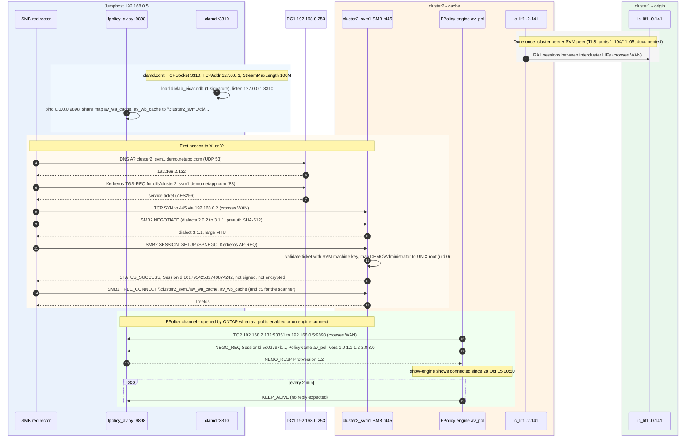
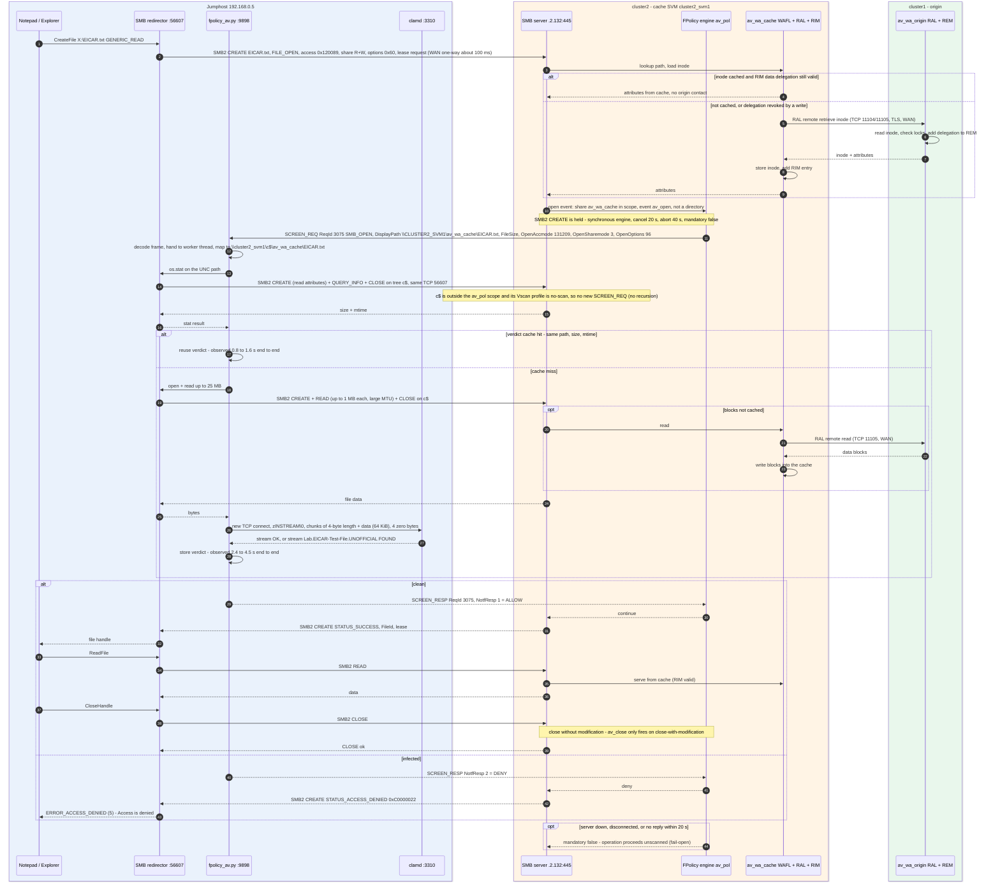
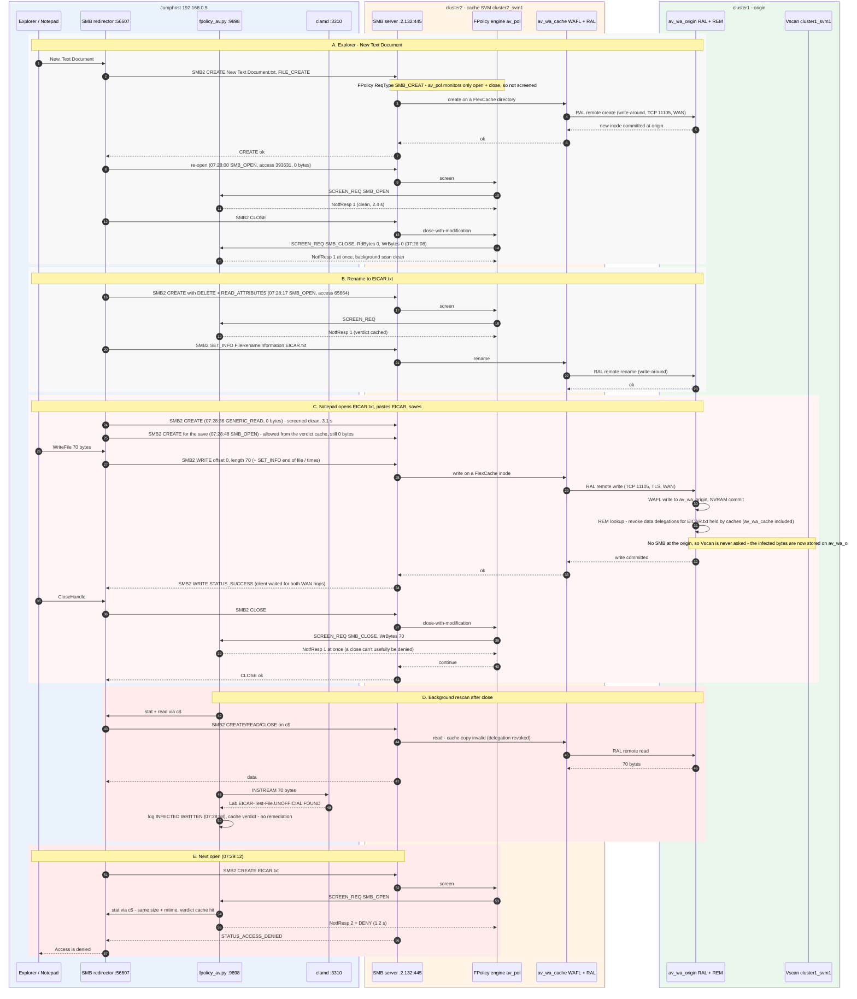
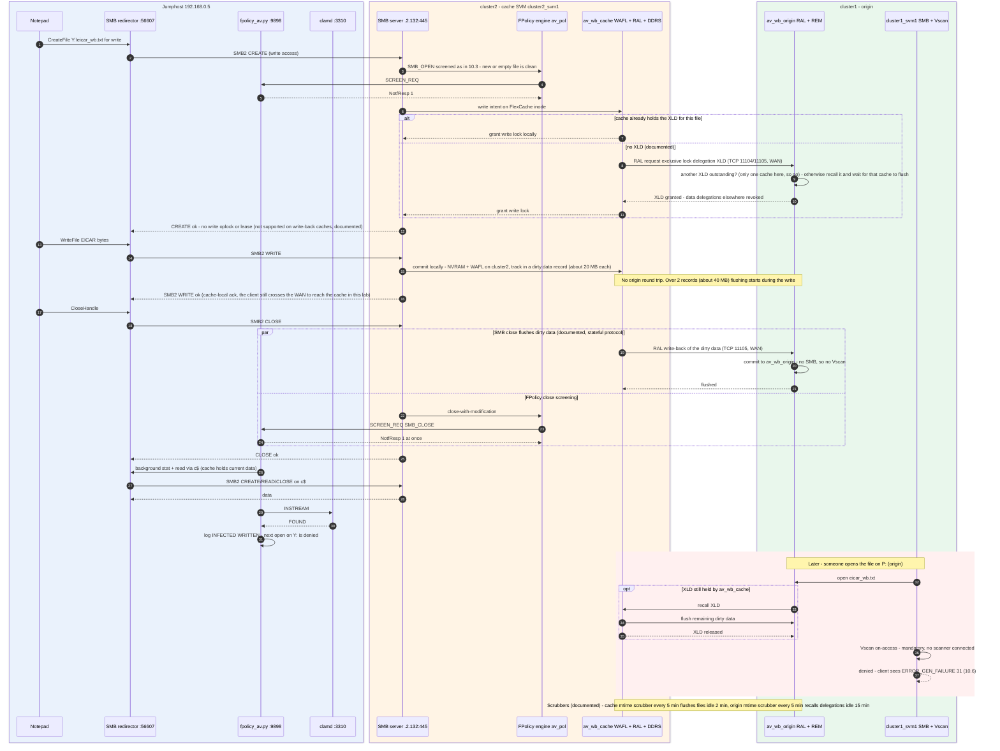
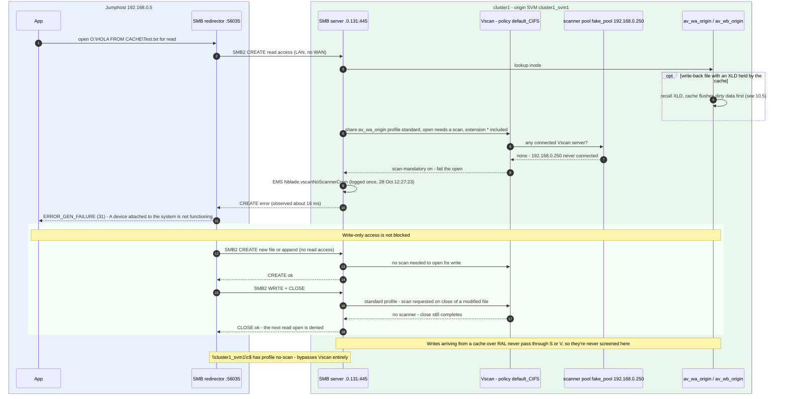

# FlexCache and Antivirus - Lab Findings and an FPolicy + ClamAV Pilot (Windows scanner)

**What this document is.** A record of a lab study of how antivirus enforcement behaves when SMB clients
reach data through FlexCache volumes (write-around and write-back), compared with going straight to the
origin. It also covers a pilot that adds content scanning at the cache with ONTAP FPolicy and the
open-source ClamAV engine. It shows what can be achieved and exactly how it was built, so it can serve
as the starting point for a pilot in your environment.

**What it is not.** The FPolicy + ClamAV scanner is a lab prototype, **not a NetApp-supported antivirus
integration**. NetApp's supported design for FlexCache is:

- on-access Vscan with a partner antivirus engine, for clients connected to the origin;
- scheduled on-demand scans at the origin (TR-4743).

A separate document, *FlexCache Antivirus Scanning with ONTAP FPolicy and ClamAV - Pilot Runbook*,
describes a Linux version of the scanner designed for a pilot.

**Lab environment.**

- ONTAP 9.19.1 on two single-node clusters (the "Getting Started with FlexCache" lab).
- A WAN emulator between them: 200 ms round trip, 400 Mbit/s.
- A Windows jumphost that maps the shares and hosts the scanner.
- Built and tested on 28-29 Oct 2026.

---

## 1. Key findings

| # | Test | Result | Meaning |
|---|------|--------|---------|
| 1 | Origin share (`O:`), Vscan on, mandatory scan, no scanner: create/write/close a file | Allowed | Vscan screens *opens*, not writes. There is no scan before a write. |
| 2 | Same share: open an existing file for read | Denied: "A device attached to the system is not functioning." | Mandatory scan blocks reads when no scanner is available. |
| 3 | Write through the write-around cache (`X:`) | Allowed; file lands on the origin | Cache writes reach the origin over the FlexCache protocol, not SMB, so they are never screened there. |
| 4 | Read through the cache (`X:`) a file the origin blocks | **Served** | The origin's Vscan does not protect reads at the cache. |
| 5 | Vscan + mandatory scan enabled on the cache SVM | Still served; ONTAP logged no Vscan event | On-access Vscan does not apply to FlexCache volumes (matches TR-4743 and the KB below). |
| 6 | FPolicy (synchronous) + ClamAV on the cache SVM, EICAR written to `X:\EICAR.txt` | Save allowed; `INFECTED WRITTEN` logged on close (07:28:58); next open denied, "Access denied" (07:29:12) | A custom (not NetApp-supported) way to screen opens at the cache. It works: the infected file is blocked at the cache from the next open. The infected bytes still land on the origin. |

References:

- TR-4743 *FlexCache in ONTAP*, section "Auditing, FPolicy and antivirus scanning": "FlexCache operations are not
  SMB operations, and therefore you must use the on-demand scanning schedule", plus Best Practice 7.
- KB: [On-access scan does not occur when accessing FlexCache volume](https://kb.netapp.com/on-prem/ontap/da/NAS/NAS-KBs/On-access_scan_does_not_occur_when_accessing_FlexCache_volume)
- [Vscan file-operations profiles](https://docs.netapp.com/us-en/ontap/antivirus/architecture-concept.html)
- [FlexCache auditing and FPolicy](https://docs.netapp.com/us-en/ontap/flexcache/audit-flexcache-volumes-concept.html)

---

## 2. Topology

```
                       192.168.0.x (data center)        WAN emulator          192.168.2.x (remote office)
                                                        200 ms / 400 Mbit
 JUMPHOST 192.168.0.5 ───────────────┐                       │
  - drives O: P: X: Y:               │                       │
  - ClamAV clamd   127.0.0.1:3310    │                       │
  - FPolicy server 0.0.0.0:9898  <───┼─── FPolicy (TCP 9898) ─┼──── cluster2_svm1 data LIF 192.168.2.132
  - ONTAP AV Connector (installed)   │                       │
                                     │                       │
 cluster1 (origin) mgmt .0.101       │                       │     cluster2 (cache) mgmt .2.102
  cluster1_svm1  data LIF .0.131     │   intercluster        │      cluster2_svm1 data LIF .2.132
   av_wa_origin (20 GB NTFS)  <──────┼── ic_lif1 .0.141 <────┼──> ic_lif1 .2.141 ──  av_wa_cache (10 GB, write-around)
   av_wb_origin (20 GB NTFS)  <──────┼───────────────────────┼─────────────────────  av_wb_cache (10 GB, write-back)
   Vscan ON (fake scanner)           │                       │      FPolicy av_pol ON, Vscan OFF
```

---

## 3. Glossary

| Entity | What it is |
|--------|-----------|
| **Origin volume** | The authoritative copy of the data (`av_wa_origin` and `av_wb_origin` on cluster1). |
| **FlexCache volume** | A sparse cache on another cluster that fills on demand from the origin (`av_wa_cache` and `av_wb_cache` on cluster2). |
| **Write-around** | Default cache mode: a write is forwarded to the origin and acknowledged only after the origin commits it. |
| **Write-back** | Per-cache mode (9.15.1+): the write is committed and acknowledged at the cache, and the dirty data is flushed to the origin later. For SMB that happens when the file is closed, when the file is accessed at the origin or another cache, or through the cache's mtime scrubber. |
| **Intercluster LIF / peering** | Network interfaces and trust relationships (cluster peer and SVM peer) that carry FlexCache traffic between the clusters. |
| **Vscan** | ONTAP's built-in antivirus framework. ONTAP sends scan requests for SMB opens, closes and renames (on-access), or on a schedule (on-demand), to external Windows scanners. |
| **Scanner pool** | List of the Vscan server IPs and privileged users allowed to connect to an SVM. |
| **Mandatory scan** | On-access policy setting: if no scanner is available, file opens that need a scan are denied. |
| **ONTAP AV Connector** | NetApp Windows service (`ontapavc`) that connects a Vscan server to ONTAP. It works only with partner AV engines (Trellix, Trend Micro, Symantec, SentinelOne, OPSWAT and others) through a partner interface. Installed in the lab, but not configured, because no partner engine was available. |
| **FPolicy** | ONTAP's file-access notification framework. With a **synchronous external engine**, ONTAP sends each monitored operation to an external TCP server and waits for an allow or deny answer. Supported on FlexCache volumes over SMB from 9.14.1. |
| **FPolicy server** | Any program that speaks the FPolicy protocol (framed XML over TCP). Here it is `fpolicy_av.py`. |
| **`fpolicy_av.py`** | Python FPolicy server written for this pilot (lab prototype). It receives SMB open and close events from the cache SVM, reads the file through an out-of-scope path (`c$`), sends it to ClamAV and answers ONTAP with allow or deny. |
| **ClamAV / `clamd`** | Open-source antivirus engine (Cisco Talos). `clamd` is its scanning daemon, which accepts data over TCP (the `INSTREAM` command). |
| **EICAR** | Industry-standard, harmless 68-byte test string that every AV engine detects as "infected". |

---

## 4. What was provisioned and how

All ONTAP commands were run in the ONTAP CLI of each cluster (clustershell over SSH).

### 4.1 Intercluster networking and peering
```text
cluster1::> net int create -vserver cluster1 -lif ic_lif1 -address 192.168.0.141 -netmask 255.255.255.0 -home-node cluster1-01 -home-port e0d -service-policy default-intercluster
cluster2::> net int create -vserver cluster2 -lif ic_lif1 -address 192.168.2.141 -netmask 255.255.255.0 -home-node cluster2-01 -home-port e0e -service-policy default-intercluster
cluster1::> cluster peer create -peer-addrs 192.168.2.141 -generate-passphrase -applications snapmirror,flexcache
    # completed on cluster2 with "cluster peer create" (or REST: POST /api/cluster/peers)
cluster2::> vserver peer create -vserver cluster2_svm1 -peer-vserver cluster1_svm1 -peer-cluster cluster1 -applications snapmirror,flexcache
cluster1::> vserver peer accept -vserver cluster1_svm1 -peer-vserver cluster2_svm1
```

### 4.2 Origin volumes and shares (cluster1)
```text
vol create -vserver cluster1_svm1 -volume av_wa_origin -aggregate cluster1_01_SSD_1 -size 20g -security-style ntfs -junction-path /av_wa_origin -space-guarantee none
vol create -vserver cluster1_svm1 -volume av_wb_origin -aggregate cluster1_01_SSD_1 -size 20g -security-style ntfs -junction-path /av_wb_origin -space-guarantee none
vserver cifs share create -vserver cluster1_svm1 -share-name av_wa_origin -path /av_wa_origin
vserver cifs share create -vserver cluster1_svm1 -share-name av_wb_origin -path /av_wb_origin
```

### 4.3 FlexCache volumes and shares (cluster2)
```text
vol flexcache create -vserver cluster2_svm1 -volume av_wa_cache -origin-vserver cluster1_svm1 -origin-volume av_wa_origin -aggr-list cluster2_01_SSD_1 -size 10g -junction-path /av_wa_cache
vol flexcache create -vserver cluster2_svm1 -volume av_wb_cache -origin-vserver cluster1_svm1 -origin-volume av_wb_origin -aggr-list cluster2_01_SSD_1 -size 10g -junction-path /av_wb_cache
set advanced
volume flexcache config modify -vserver cluster2_svm1 -volume av_wb_cache -is-writeback-enabled true
set admin
vserver cifs share create -vserver cluster2_svm1 -share-name av_wa_cache -path /av_wa_cache
vserver cifs share create -vserver cluster2_svm1 -share-name av_wb_cache -path /av_wb_cache
```

### 4.4 Data population
`robocopy` from the jumphost into **both origins** (over the LAN; the caches fill on demand):
`C:\Python311` → `Python311`, `C:\Windows\Web|Media|Help` → `Windows_*`, `C:\Program Files\PuTTY` → `PuTTY`, and the
VSCodium installer → `Installers`. About 11,353 files and 404 MB per origin.

### 4.5 Drive mappings on the jumphost (persistent)
| Drive | Share | Role |
|-------|-------|------|
| `O:` | `\\cluster1_svm1\av_wa_origin` | Origin of the write-around cache |
| `P:` | `\\cluster1_svm1\av_wb_origin` | Origin of the write-back cache |
| `X:` | `\\cluster2_svm1\av_wa_cache` | Write-around cache (across the WAN) |
| `Y:` | `\\cluster2_svm1\av_wb_cache` | Write-back cache (across the WAN) |

### 4.6 ONTAP AV Connector 1.0.7P1 (installed, not configured)

- Installed silently from the MSI inside the NetApp installer. The `ontapavc` service starts
  automatically under a domain account.
- No LIFs are configured and no AV engine is behind it, because no partner engine licence was
  available. The jumphost IP is not in any scanner pool, so the connector does not affect the tests.
- It is kept for a later test with a partner engine (Vscan at the origin, the supported design).

### 4.7 Vscan "no-scanner" configuration
Origin (`cluster1_svm1`), **enabled**:
```text
vserver vscan scanner-pool create -vserver cluster1_svm1 -scanner-pool fake_pool -hostnames 192.168.0.250 -privileged-users "DEMO\Administrator"
vserver vscan scanner-pool apply-policy -vserver cluster1_svm1 -scanner-pool fake_pool -scanner-policy primary
vserver cifs share modify -vserver cluster1_svm1 -share-name c$ -vscan-fileop-profile no-scan
vserver cifs share modify -vserver cluster1_svm1 -share-name cluster1_svm1_ntfs_fc_origin -vscan-fileop-profile no-scan
vserver cifs share modify -vserver cluster1_svm1 -share-name cluster1_svm1_unix_fc_origin -vscan-fileop-profile no-scan
vserver vscan enable -vserver cluster1_svm1
```
The default on-access policy `default_CIFS` was left as is: mandatory scan on, extensions `*`, files with no extension included.
192.168.0.250 is an unused IP, so no scanner ever connects.

Cache (`cluster2_svm1`): same configuration with `fake_pool` = 192.168.2.250 and `c$` set to `no-scan`. Vscan is now
**disabled** there (`vserver vscan disable`) because it had no effect on FlexCache volumes; the pool still exists.

### 4.8 ClamAV 1.5.4 (portable, no install)
| Item | Location |
|------|----------|
| Binaries | `C:\AV LAB\clamav\bin\clamav-1.5.4.win.x64\` (from the GitHub release zip) |
| Config | `C:\AV LAB\clamav\clamd.conf`: `TCPSocket 3310`, `TCPAddr 127.0.0.1`, `StreamMaxLength 100M` |
| Signatures | `C:\AV LAB\clamav\db\lab_eicar.ndb`: one custom EICAR signature (`Lab.EICAR-Test-File`) |
| Log | `C:\AV LAB\clamav\clamd.log` |

The official signature mirrors (`database.clamav.net`) return HTTP 403 from this lab, so only the custom signature is
loaded. ClamAV reports detections as `Lab.EICAR-Test-File.UNOFFICIAL`.

### 4.9 FPolicy on the cache SVM (cluster2)
```text
vserver fpolicy policy external-engine create -vserver cluster2_svm1 -engine-name av_engine -primary-servers 192.168.0.5 -port 9898 -extern-engine-type synchronous -ssl-option no-auth -extern-engine-format xml
vserver fpolicy policy event create -vserver cluster2_svm1 -event-name av_open  -protocol cifs -file-operations open  -filters exclude-directory
vserver fpolicy policy event create -vserver cluster2_svm1 -event-name av_close -protocol cifs -file-operations close -filters close-with-modification,exclude-directory
vserver fpolicy policy create -vserver cluster2_svm1 -policy-name av_pol -events av_open,av_close -engine av_engine -is-mandatory false
vserver fpolicy policy scope create -vserver cluster2_svm1 -policy-name av_pol -shares-to-include av_wa_cache,av_wb_cache
vserver fpolicy enable -vserver cluster2_svm1 -policy-name av_pol -sequence-number 1
```

- The scope covers only the two cache shares. The server reads files through `\\cluster2_svm1\c$\...`, which is out of
  scope, so its own reads do not trigger FPolicy events.
- `-is-mandatory false`: if the server is down, opens are **allowed** (fail-open), so the lab can't lock itself out.

### 4.10 `fpolicy_av.py` (the FPolicy server)
Location: `C:\AV LAB\fpolicy\fpolicy_av.py`. Uses only the Python 3.11 standard library.

How it works:

1. **Framing:** each message is `"` + 4-byte big-endian length + `"` + XML header + `\n\n` + XML body + NUL.
2. **Handshake:** answers `NEGO_REQ` with `NEGO_RESP` (`<HandshakeResp>`, highest common version; ONTAP 9.19.1 negotiates 1.2).
3. **`SCREEN_REQ` `SMB_OPEN`:**
    - Maps `\\CLUSTER2_SVM1\<share>\<path>` to `\\cluster2_svm1\c$\<share>\<path>`.
    - Scans the file with clamd (`INSTREAM`), or with a built-in EICAR matcher if clamd is down.
    - Answers ONTAP with `<FscreenResp><ReqId/><ReqType/><NotfResp>N</NotfResp></FscreenResp>`.
4. **`SCREEN_REQ` `SMB_CLOSE`** (modified files only): allows immediately, rescans in the background and logs
   `INFECTED WRITTEN` when it finds something.
5. **Verdict cache:** results are cached by path, size and mtime. Files over 25 MB are skipped (allowed and logged as `skipped-too-large`).

`NotfResp` codes, found by testing against 9.19.1:

| Code | Meaning |
|------|---------|
| `1` | Allow |
| `2` | Deny (client sees "Access denied") |
| `0` | Invalid: ONTAP sends a FATAL alert and drops the connection |

Logs:

| File | Content |
|------|---------|
| `C:\AV LAB\fpolicy\fpolicy_av.log` | `ALLOW`, `DENY`, `INFECTED WRITTEN`, connects and disconnects |
| `C:\AV LAB\fpolicy\fpolicy_av_raw.log` | The first 10 raw `SCREEN_REQ` XML bodies |

Options: `--allow-code`, `--deny-code`, `--max-mb`, `--clamd-host`, `--clamd-port`, `--port`, `--raw-dump`.
Diagnostics: with `--probe-codes`, a file whose name contains `__probeN__` makes the server answer with code `N`. It was used once to find the codes above; in the scanner kit it is off by default (see section 7).

Public reference implementations consulted: Yoshiki0705/FSx-for-ONTAP-S3AccessPoints-Serverless-Patterns,
YhunerFSY/ontap-fpolicy-aws-integration, AhmedRamadanAbdElghany/fpolicyServer and Esraayasser/Netapp-Fpolicy-External-Server.

---

## 5. Operating the scanner stack

| Task | How |
|------|-----|
| Start (safe to re-run) | `powershell -File "C:\AV LAB\fpolicy\start_av_scanner.ps1"` |
| Force ONTAP to reconnect | `cluster2::> vserver fpolicy engine-connect -node cluster2-01 -vserver cluster2_svm1 -policy-name av_pol -server 192.168.0.5` |
| Connection status | `cluster2::> vserver fpolicy show-engine -vserver cluster2_svm1` |
| Watch decisions live | `Get-Content 'C:\AV LAB\fpolicy\fpolicy_av.log' -Wait -Tail 20` |
| Stop the FPolicy server | `Get-NetTCPConnection -LocalPort 9898 -State Listen \| % { Stop-Process -Id $_.OwningProcess }` |
| Stop clamd | `Get-NetTCPConnection -LocalPort 3310 -State Listen \| % { Stop-Process -Id $_.OwningProcess }` |
| Pause screening (keep config) | `cluster2::> vserver fpolicy disable -vserver cluster2_svm1 -policy-name av_pol` |
| Resume screening | `cluster2::> vserver fpolicy enable -vserver cluster2_svm1 -policy-name av_pol -sequence-number 1` |
| ONTAP-side FPolicy and Vscan events | `event log show -message-name *fpolicy*` / `*vscan*` |

---

## 6. Test procedures and results

EICAR string (type it exactly, on one line):
`X5O!P%@AP[4\PZX54(P^)7CC)7}$EICAR-STANDARD-ANTIVIRUS-TEST-FILE!$H+H*`

| ID | Steps | Expected with this configuration | Lab result |
|----|-------|----------------------------------|------------|
| FP-1 | Notepad → save the EICAR string as `X:\eicar_wa.txt` → close | Save succeeds; the log shows `INFECTED WRITTEN` | Observed with `X:\EICAR.txt` (29 Oct, 07:28:58) |
| FP-2 | Open `X:\eicar_wa.txt` again | "Access denied"; the log shows `DENY SMB_OPEN ... Lab.EICAR-Test-File` | Observed (07:29:12, answered in 1.2 s) |
| FP-3 | Repeat FP-1 and FP-2 on `Y:` (write-back) | Same result at the cache | Pilot step, not run yet |
| FP-4 | After FP-3, list `P:\` (do not open the file) | The file is on the origin: SMB close flushes the dirty data, and the cache scan does **not** stop the flush | Pilot step, not run yet (expected from NetApp documentation) |
| FP-5 | Open the EICAR file on `O:` or `P:` | Blocked by the origin's no-scanner Vscan (not a detection, just "no scanner") | Same mechanism observed with other files (findings 1 and 2) |
| FP-6 | Open any clean file on `X:` or `Y:` | Opens; the log shows `ALLOW ... clean via clamav` | Observed on `X:` (0.8-4.5 s per open) |
| FP-7 | Stop the FPolicy server, then open the EICAR file on `X:` | **Opens** (fail-open, because `-is-mandatory false`) | Pilot step, not run yet |
| FP-8 | Same as FP-7 with `vserver fpolicy policy modify -vserver cluster2_svm1 -policy-name av_pol -is-mandatory true` | Denied while the server is down (fail-closed) | Pilot step, not run yet |

Notes:

- **Latency:** each screened open costs 0.8-4.5 s, because the scanner is on the far side of the WAN from cluster2. Browsing `X:` and `Y:` in Explorer is slow.
- **Deleting an infected file** through `X:` or `Y:` is also denied, because a delete requires an open. Delete it through `\\cluster2_svm1\c$\av_wa_cache\...` or `...\av_wb_cache\...`.
- **Reopening:** close Notepad first. Otherwise the Windows SMB client may serve the file from its own cache.
- **Packet captures (planned):** SMB2 between the jumphost and 192.168.2.132, FPolicy on TCP 9898, and FlexCache traffic between the two `ic_lif1` interfaces.

---

## 7. Limitations and security notes

- **Not a NetApp-supported antivirus integration.** `fpolicy_av.py` is a lab prototype. The supported design
  for FlexCache is on-access Vscan for clients connected to the origin plus scheduled **on-demand** scans at
  the origin (TR-4743, Best Practice 7); both need a partner AV engine.
- **Write path:** content is scanned after it is written (at close), so infected bytes reach the origin and
  only the next open at the cache is blocked. Nothing is quarantined or deleted.
- **Performance:**
    - Each screened open costs 0.8-4.5 s here, because the scanner is across the 200 ms WAN from the cache.
    - Screening opens on a cache forces path lookups at the origin.
    - NetApp advises against monitoring read and getattr operations on FlexCache volumes, for performance reasons.
- **Large files:** files over 25 MB are allowed without a scan in this build.
- **Fail-open:** with `-is-mandatory false`, an open is allowed unscanned while the server is down. The same
  happens when the server doesn't answer within ONTAP's 20 s timeout.
- **Privileges and exposure (acceptable in an isolated lab only):**
    - The scanner reads files through the `c$` administrative share as a domain administrator.
    - The FPolicy channel (TCP 9898) is unauthenticated plain text.
    - The jumphost firewall is off.
- **Diagnostic codes:** the `__probeN__` file-name diagnostic lets a file name choose the answer. It is off by default in the scanner kit and must stay off beyond the lab.
- **Signatures:** ClamAV has only the custom EICAR signature (the official database wasn't reachable from
  the lab), so it detects nothing else.
- **Scale:** a single scanner with an in-memory verdict cache.

The Linux pilot design (separate pilot runbook) addresses most of these:

- the scanners run next to the cache;
- files are read through a read-only `scan$` share as a dedicated service account;
- large files are scanned in the background;
- the scanner always answers within a deadline, and can fail closed;
- a verdict cache can be shared by several scanners;
- diagnostic codes are off by default.

---

## 8. Rollback and teardown

```text
# cache side (cluster2)
vserver fpolicy disable -vserver cluster2_svm1 -policy-name av_pol
vserver fpolicy policy scope delete -vserver cluster2_svm1 -policy-name av_pol
vserver fpolicy policy delete -vserver cluster2_svm1 -policy-name av_pol
vserver fpolicy policy event delete -vserver cluster2_svm1 -event-name av_open
vserver fpolicy policy event delete -vserver cluster2_svm1 -event-name av_close
vserver fpolicy policy external-engine delete -vserver cluster2_svm1 -engine-name av_engine
vserver vscan scanner-pool apply-policy -vserver cluster2_svm1 -scanner-pool fake_pool -scanner-policy idle
vserver vscan scanner-pool delete -vserver cluster2_svm1 -scanner-pool fake_pool

# origin side (cluster1)
vserver vscan disable -vserver cluster1_svm1
vserver vscan scanner-pool apply-policy -vserver cluster1_svm1 -scanner-pool fake_pool -scanner-policy idle
vserver vscan scanner-pool delete -vserver cluster1_svm1 -scanner-pool fake_pool
vserver cifs share modify -vserver cluster1_svm1 -share-name <share> -vscan-fileop-profile standard   # c$ and the two pre-existing lab shares
```
Jumphost: stop both processes (section 5). Uninstall "ONTAP AV Connector" from Programs and Features if no longer needed.

---

## 9. Components on the scanner host

The `windows-scanner-kit` folder delivered with this document holds everything below except Python
(see its `README.txt`). Copied to `C:\AV LAB`, its paths match this runbook.

| Path | Purpose |
|------|---------|
| `C:\AV LAB\clamav\bin\clamav-1.5.4.win.x64\` | ClamAV 1.5.4 for Windows x64 (runtime files of the official release) |
| `C:\AV LAB\clamav\db\lab_eicar.ndb` | Test signature: detects the EICAR string anywhere in a file |
| `C:\AV LAB\clamav\clamd.conf`, `clamd.log` | Written by the start script and by `clamd` |
| `C:\AV LAB\fpolicy\fpolicy_av.py` | FPolicy AV server |
| `C:\AV LAB\fpolicy\start_av_scanner.ps1`, `stop_av_scanner.ps1` | Start and stop `clamd` and the FPolicy server |
| `C:\AV LAB\fpolicy\update_signatures.ps1` | Optional: downloads the official ClamAV signatures |
| `C:\AV LAB\fpolicy\fpolicy_av*.log` | Decision log and raw request dump |

The ONTAP AV Connector used in the lab isn't part of the kit. It is available from the NetApp Support
Site and is only needed with a partner antivirus engine.

---

## 10. Detailed data-path schemas

Built from this lab's live state on 29 Oct 2026. Sources:

- ONTAP `show` output: SMB sessions, the FPolicy engine and connection, and the Vscan pool.
- The jumphost TCP table and routing table.
- The raw FPolicy requests in `fpolicy_av_raw.log`, and the decision log of the EICAR test.

Steps marked **documented** come from NetApp documentation (TR-4743, the FlexCache write-back architecture page, and the
FlexCache ports KB) and could not be observed directly in the lab.

### 10.1 Connection map

<!--SVG:connection_map-->

| # | Socket (observed unless marked) | Protocol | Carries | Encrypted on the wire | Visible in a capture |
|---|------|----------|---------|-----------|----------------------|
| 1 | `192.168.0.5:56607` → `192.168.2.132:445` | SMB 3.1.1, Kerberos, session `10179542532740874242` | Everything on `X:` and `Y:`, plus the scanner's `c$` reads (same TCP connection, separate tree connect) | No (`Is Session Signed: false`, `unencrypted`) | Fully decodable SMB2 |
| 2 | `192.168.0.5:56035` → `192.168.0.131:445` | SMB 3.1.1, Kerberos | Everything on `O:` and `P:` | No | Fully decodable SMB2 |
| 3 | `192.168.2.132:53351` → `192.168.0.5:9898` | FPolicy external engine, XML, synchronous, `ssl-option no-auth` | NEGO, SCREEN_REQ/RESP, KEEP_ALIVE, ALERT | No | Plain XML ("Follow TCP stream") |
| 4 | `127.0.0.1:<ephemeral>` → `127.0.0.1:3310` | clamd `INSTREAM` | File bytes and verdict | No | Only with a loopback capture (Npcap loopback adapter) |
| 5 | `192.168.2.141` ↔ `192.168.0.141` (documented) | RAL: TCP 11104 control sessions, 11105 data | Inode fetch, block reads, remote writes, XLD, delegation revokes, write-back flush | Yes (cluster peering TLS) | Headers and timing only |
| 6 | Jumphost → `192.168.0.253` | DNS 53, Kerberos 88 | Name lookup for `cluster*_svm1`, tickets for `cifs/...` | Kerberos tickets are encrypted | Decodable headers |
| 7 | `fake_pool` 192.168.0.250 → `192.168.0.131` (never happens) | Vscan (a scanner connects to the SVM) | Would carry scan requests | – | Nothing; that's why mandatory scan denies |

Every packet between `192.168.0.x` and `192.168.2.x` crosses the WAN emulator. The jumphost route is
`192.168.2.0/24 via 192.168.0.2`. One FPolicy screening therefore costs at least two WAN round trips:
one for SCREEN_REQ/RESP and one or more for the scanner's own SMB reads back to the cache.

**Jumphost process and socket inventory** (live, `Get-NetTCPConnection` / `Win32_Process`, 29 Oct 09:15)

| Process | PID | Socket | State | Notes |
|---------|-----|--------|-------|-------|
| `python.exe fpolicy_av.py` | 3516 | `0.0.0.0:9898` | LISTEN | Main thread: `listen(16)` and `accept()`. Reachable from any host, because the Windows firewall is off and FPolicy `no-auth` has no authentication. |
| | | `192.168.0.5:9898` ↔ `192.168.2.132:53351` | ESTABLISHED | The only FPolicy connection. Opened by ONTAP (connected since 28 Oct 15:00:50). One reader thread, 600 s read timeout, keep-alive every 2 min. |
| | | `127.0.0.1:<ephemeral>` → `127.0.0.1:3310` | short-lived | One connection per scan: 15 s timeout, 64 KiB `INSTREAM` chunks, closed after the reply. |
| | | none (file I/O) | – | `os.stat` / `open` on `\\cluster2_svm1\c$\...` go through the kernel SMB redirector. |
| `clamd.exe` | 5512 | `127.0.0.1:3310` | LISTEN | Loopback only. `MaxThreads 16`, `StreamMaxLength 100M`, database self-check every 600 s. |
| System (SMB redirector) | 4 | `192.168.0.5:56607` → `192.168.2.132:445` | ESTABLISHED | `X:`, `Y:` and the scanner's `c$` reads (shared connection, separate tree connect). |
| | | `192.168.0.5:56035` → `192.168.0.131:445` | ESTABLISHED | `O:`, `P:` |
| `ontapavc.exe` (AV Connector) | 7084 | none | – | Not configured. Once LIFs are added it would use HTTPS 443 to the management LIF (REST polling every 60 s) and SMB 445 to the data LIFs. |
| DNS client | – | UDP → `192.168.0.253:53` | on demand | Resolves `cluster2_svm1` for the UNC path. |

### 10.2 Session and channel setup (happens before any file operation)



### 10.3 Open (read) through the write-around cache `X:`

Notepad opening `X:\EICAR.txt`. The field values are from the real request captured at 07:28:36 (ReqId 3075).



| Step | Detail |
|------|--------|
| CREATE held | ONTAP doesn't answer the client's CREATE until the FPolicy server responds or the request times out. The client waits the whole time, including two WAN crossings for FPolicy and the scanner's own SMB round trips. |
| Why the screen request carries `FileSize` | ONTAP resolves the inode first (from the cache, or through RAL from the origin), then builds the notification. |
| Scanner path | The server never reads through `av_wa_cache` itself. It reads through `c$`, which is out of scope, so its reads are never screened. |
| Verdict cache | Key = (path, size, mtime). Notepad's save changes size and mtime, so the next open rescans. A cached verdict still costs one stat round trip. |
| Origin contact on a clean cached read | None if the RIM data delegation is still valid (documented, TR-4743 "File cached and valid"). |

### 10.4 Write through the write-around cache `X:`

This is the lab's EICAR test, as it ran on 29 Oct (times from `fpolicy_av.log`).



### 10.5 Write through the write-back cache `Y:`



### 10.6 Open on the origin `O:` or `P:` (Vscan, no scanner)



### 10.7 Message formats, decoded fields, timers and observed timings

**FPolicy frame (TCP 9898, both directions)**

| Bytes | Content |
|-------|---------|
| 1 | `"` (0x22) |
| 4 | Payload length, big-endian |
| 1 | `"` (0x22) |
| n | `<?xml version="1.0"?><Header><NotfType>…</NotfType><ContentLen>…</ContentLen><DataFormat>XML</DataFormat></Header>` |
| 2 | `\n\n` separator |
| m | `<?xml version="1.0"?>` + body XML (`ContentLen` = m) |
| 1 | NUL terminator |

**Message types seen in this lab**

| Type | Direction | Key fields |
|------|-----------|------------|
| `NEGO_REQ` | ONTAP → server | `SessionId`, `VsUUID`, `PolicyName` = `av_pol`, `Vers` 1.0 1.1 1.2 2.0 3.0 |
| `NEGO_RESP` | server → ONTAP | `HandshakeResp`: same `SessionId`, `VsUUID`, `PolicyName`, `ProtVersion` = 1.2 |
| `SCREEN_REQ` | ONTAP → server | `FscreenReq`: `ReqId`, `ReqType` (`SMB_OPEN`, `SMB_CLOSE`), `NotfInfo` |
| `SCREEN_RESP` | server → ONTAP | `FscreenResp`: `ReqId`, `ReqType`, `NotfResp` (1 = allow, 2 = deny, 0 = invalid, which ONTAP treats as fatal) |
| `KEEP_ALIVE` | ONTAP → server | Every 2 min, no reply |
| `ALERT_MSG` | ONTAP → server | Seen once: `FATAL` "The screen response message received from the FPolicy server is not valid." (the `NotfResp 0` probe) |

**Real SCREEN_REQ (Notepad opening `X:\EICAR.txt`, 07:28:36)**

```xml
<FscreenReq>
  <ReqId>3075</ReqId>
  <ReqType>SMB_OPEN</ReqType>
  <NotfInfo><SmbOpenReq>
    <CommonInfo>
      <ProtCommonInfo>
        <ClientIp>192.168.0.5</ClientIp>
        <GenerationTime>1793258915717898</GenerationTime>
        <UsrIdType>MAPPED_ID</UsrIdType>
        <UsrContext><MappedId><Uid>0</Uid><WinSid>S-1-5-21-4254325344-3421351856-2746113450-500</WinSid></MappedId></UsrContext>
        <FileOwner><WinSid>S-1-5-32-544</WinSid></FileOwner>
        <AccessPath>
          <Path><PathNameType>WIN_NAME</PathNameType><PathName>\EICAR.txt</PathName></Path>
          <Path><PathNameType>UNIX_NAME</PathNameType><PathName>/EICAR.txt</PathName></Path>
        </AccessPath>
        <VolMsid>2160101725</VolMsid>
        <FileSize>0</FileSize><NumHardLnk>1</NumHardLnk><IsOfflineAttr>0</IsOfflineAttr>
        <FileType>FILE</FileType><IsSparse>0</IsSparse><IsDense>0</IsDense>
      </ProtCommonInfo>
      <DisplayPath>\\CLUSTER2_SVM1\av_wa_cache\EICAR.txt</DisplayPath>
      <ProtVer><MajorNum>3</MajorNum><MinorNum>1</MinorNum></ProtVer>
    </CommonInfo>
    <OpenAccmode>131209</OpenAccmode>
    <OpenSharemode>3</OpenSharemode>
    <OpenOptions>96</OpenOptions>
  </SmbOpenReq></NotfInfo>
</FscreenReq>
```

**Decoded fields**

| Field | Value | Meaning |
|-------|-------|---------|
| `UsrContext` | `Uid 0`, SID `…-500` | `DEMO\Administrator`, name-mapped to UNIX `root` (matches `vserver cifs session show`) |
| `FileOwner` | `S-1-5-32-544` | `BUILTIN\Administrators` |
| `VolMsid` | `2160101725` | MSID of `av_wa_cache` |
| `ProtVer` | 3.1 | SMB 3.1.1 session |
| `OpenAccmode` 131209 | `0x20089` | READ_CONTROL + READ_ATTRIBUTES + READ_EA + READ_DATA (generic read) |
| `OpenAccmode` 393631 | `0x6019F` | WRITE_DAC + READ_CONTROL + DELETE + read/write data, attributes, EA (Explorer reopening a new file) |
| `OpenAccmode` 65664 | `0x10080` | DELETE + READ_ATTRIBUTES (Explorer rename) |
| `OpenSharemode` | 0, 1, 3, 7 | none, read, read + write, read + write + delete |
| `OpenOptions` 96 / 100 | `0x60` / `0x64` | NON_DIRECTORY_FILE + SYNCHRONOUS_IO_NONALERT (+ SEQUENTIAL_ONLY) |
| `OpenOptions` 4194404 | `0x400064` | as above + OPEN_NO_RECALL (PowerShell / .NET) |
| `OpenOptions` 2097184 | `0x200020` | OPEN_REPARSE_POINT + SYNCHRONOUS_IO_NONALERT |
| `SmbCloseReq` | `RdBytes`, `WrBytes` | Bytes read and written on that handle |

**SCREEN_RESP sent by `fpolicy_av.py`**

```xml
<?xml version="1.0"?><Header><NotfType>SCREEN_RESP</NotfType><ContentLen>…</ContentLen><DataFormat>XML</DataFormat></Header>

<?xml version="1.0"?><FscreenResp><ReqId>3075</ReqId><ReqType>SMB_OPEN</ReqType><NotfResp>2</NotfResp></FscreenResp>
```

**clamd INSTREAM (TCP 127.0.0.1:3310, one connection per scan)**

| Direction | Bytes |
|-----------|-------|
| → | `zINSTREAM\0` |
| → | For each chunk of up to 64 KiB: 4-byte big-endian length + data |
| → | `00 00 00 00` (end of stream) |
| ← | `stream: OK\0` or `stream: Lab.EICAR-Test-File.UNOFFICIAL FOUND\0` |

The signature in `lab_eicar.ndb` is `Lab.EICAR-Test-File:0:*:<hex of the 68-byte string>`: target any file type, at any offset.

**Timers in effect**

| Component | Setting | Value |
|-----------|---------|-------|
| FPolicy engine `av_engine` | Cancel request / abort request | 20 s / 40 s |
| | Status request interval | 10 s |
| | Keep-alive interval | 2 min |
| | Disconnect non-responsive server | 1 min |
| | Max outstanding requests / reconnect attempts | 500 / 5 |
| | Receive / send buffer | 256 KiB / 1 MiB |
| FPolicy policy `av_pol` | Mandatory | false (fail-open) |
| Vscan `fake_pool` (cluster1) | Request service / scan queue / session setup timeout | 30 s / 20 s / 10 s |
| Write-back (documented) | Dirty data record size / flush start | ~20 MB / after ~40 MB |
| | Cache mtime scrubber | every 5 min, files idle 2 min |
| | Origin mtime scrubber | every 5 min, recalls delegations idle 15 min |
| Windows SMB client | Directory / file info / file-not-found cache | 10 s / 10 s / 5 s |

**Observed timings (decision log)**

| Event | End-to-end time |
|-------|-----------------|
| Origin open denied by Vscan (no scanner) | ~16 ms |
| FPolicy open, first scan | 2.4–4.5 s |
| FPolicy open, cached verdict | 0.8–1.6 s |
| FPolicy deny from the verdict cache | 1.2 s |

**Where to capture**

| Capture point | Command or tool | What you get |
|---------------|-----------------|--------------|
| Jumphost NIC | Wireshark (if installed), or `netsh trace start capture=yes` then convert the `.etl` | SMB2 to both SVMs (clear text), FPolicy XML on 9898 (clear text) |
| Jumphost loopback | Npcap loopback adapter | clamd `INSTREAM` on 3310 |
| cluster2 port `e0e` (data LIF and `ic_lif1`) | `network tcpdump start -node cluster2-01 -port e0e` / `network tcpdump stop ...` (check the options with `?`) | Client SMB, FPolicy, RAL (TLS) on the cache side |
| cluster1 ports `e0h` (data) / `e0d` (`ic_lif1`) | `network tcpdump start -node cluster1-01 -port e0d` | RAL (TLS) at the origin, origin SMB |

---

## 11. From lab to pilot

What the lab shows can be achieved, and what a pilot would add:

| Area | Lab (this document) | Pilot (Linux pilot runbook) |
|------|---------------------|-------------------------------|
| Where scanning happens | At the FlexCache, on open and after close | Same, alongside the supported on-demand scans at the origin |
| Scanner hosts | 1 Windows host across the WAN | 2-3 Linux hosts (for example EC2) on the cache's LAN or VPC, load-shared by ONTAP |
| File access | `c$` as a domain administrator | Read-only `scan$` share, dedicated service account |
| Large files | Over 25 MB not scanned | Up to 100 MB scanned while the open waits; larger files scanned in the background |
| Verdicts | In memory, one scanner | Shared Redis/Valkey cache, optional automatic failover |
| Failure handling | Fail-open | Fail-open or fail-closed, always answered before ONTAP's timeout |
| AV engine | ClamAV with a test signature | ClamAV with the official signatures (a commercial engine with a scanning interface could replace it; to be confirmed with the vendor) |
| FPolicy channel | Plain text, no authentication | Restricted to the SVM data LIFs (security groups / allow list); FPolicy TLS optional |

Suggested pilot success criteria:

1. EICAR written through each cache type is blocked at the next open (FP-1 to FP-3).
2. Clean-file open latency stays within an agreed budget.
3. No unscanned opens during scanner restarts with fail-closed (FP-8).
4. Measured open and scan rates are recorded, for sizing.
